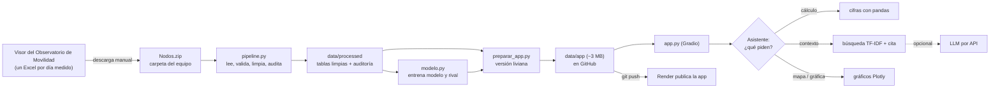

# Bogotá se Mueve

Proyecto académico de la **Mesa 1** (asignatura DIGD, docente Nelson Gustavo Fajardo Belmonte) para el reto de datos de la Alcaldía de Bogotá (DDIPEA) sobre **confianza y apropiación de los datos públicos**. Se presentó en **Synexis · Tech Innovate Summit**, de la Escuela Colombiana de Ingeniería Julio Garavito.

- **App publicada:** https://bogota-se-mueve.onrender.com
- **Código:** este repositorio

**En una frase:** tomamos los conteos de vehículos que publica la Secretaría Distrital de Movilidad (SDM), los revisamos y limpiamos sin esconder sus errores, y los explicamos en lenguaje claro, con gráficos y con la fuente de cada cifra. Para eso usamos una app con un asistente que responde preguntas y un modelo que estima el tráfico de un día típico.

Este documento está escrito para dos públicos:
- **Si no eres técnico**, lee las secciones 1 a 4 y 10 a 14.
- **Si eres técnico**, las secciones 5 a 9 y 15 explican cada archivo y cada decisión.

## Índice
1. [Qué puedes hacer en la app](#1-qué-puedes-hacer-en-la-app)
2. [Alcance: qué puntos, qué zona y qué años](#2-alcance-qué-puntos-qué-zona-y-qué-años)
3. [Cómo funciona, paso a paso](#3-cómo-funciona-paso-a-paso)
4. [Qué preguntas responde y por qué de esa manera](#4-qué-preguntas-responde-y-por-qué-de-esa-manera)
5. [Archivos del repositorio, uno por uno](#5-archivos-del-repositorio-uno-por-uno)
6. [Cómo se construyó el asistente (RAG y LLM)](#6-cómo-se-construyó-el-asistente-rag-y-llm)
7. [El modelo de estimación](#7-el-modelo-de-estimación)
8. [La revisión de calidad de los datos](#8-la-revisión-de-calidad-de-los-datos)
9. [Evaluación del asistente](#9-evaluación-del-asistente)
10. [Gradio, GitHub y Render: qué hace cada uno](#10-gradio-github-y-render-qué-hace-cada-uno)
11. [Tiempos de respuesta](#11-tiempos-de-respuesta)
12. [¿Funciona en el celular?](#12-funciona-en-el-celular)
13. [Limitaciones actuales](#13-limitaciones-actuales)
14. [Próximos pasos y mayor alcance](#14-próximos-pasos-y-mayor-alcance)
15. [Qué se aplicó del curso MGIN (Datos & IA) y dónde](#15-qué-se-aplicó-del-curso-mgin-datos--ia-y-dónde)
16. [Cómo correrlo y actualizarlo](#16-cómo-correrlo-y-actualizarlo)
17. [Autores](#17-autores)

---

## 1. Qué puedes hacer en la app

| Pestaña | Para qué sirve | Ejemplo |
|---|---|---|
| **Asistente** | Hacer preguntas en tus palabras. Responde con texto, mapas o gráficos, siempre con la fuente. Debajo de cada respuesta ofrece 3 preguntas para seguir. | «¿A qué hora hay más tráfico en la Autopista Norte con 170?» · «Muéstrame el mapa de los puntos» · «¿Cómo ha cambiado el tráfico en la Vía a Cota por año?» |
| **Explorar un punto** | Ver el tráfico normal de cada hora en un punto y tipo de día (hábil, fin de semana, festivo), compararlo por año, mes o temporada, y ver la lista de días medidos. | Vía a Cota, día hábil, «Por temporada» |
| **¿Cómo estará?** | Elegir un punto y una fecha y ver cuánto tráfico se espera en cada hora y de qué tipo de vehículo. | AK 7 con Calle 208, 8 de diciembre |
| **Calidad de datos** | Ver los errores que encontramos en los archivos oficiales: qué son y en qué días. | Archivo con datos de otro punto |
| **Acerca de** | Fuentes, años, zona, cómo funciona, limitaciones, autores y vocabulario. | — |

> La primera visita del día puede tardar alrededor de un minuto mientras el servidor «despierta» (ver sección 11).

## 2. Alcance: qué puntos, qué zona y qué años

**Puntos (nodos).** El proyecto cubre **6 cruces**, todos en el **norte y noroccidente de Bogotá**. Tres de ellos son entradas o salidas de la ciudad (Vía a Cota, Carrera 7 al norte y Autopista Norte).

| Nodo | Lugar | Zona aproximada* | Días medidos | Desde | Hasta |
|---|---|---|---|---|---|
| 663 | Vía a Cota con Cra 116 | Suba (salida a Cota) | 193 | sep-2021 | nov-2026 |
| 695 | AK 7 con Calle 208 | Usaquén (salida norte) | 188 | sep-2021 | nov-2026 |
| 23692 | Calle 102A con Tv 13A Este | Usaquén (cerca de los cerros orientales) | 177 | sep-2021 | nov-2026 |
| 3493 | Autopista Norte con Calle 170 | Límite Usaquén–Suba | 20 | sep-2021 | sep-2026 |
| 10122 | Calle 171 con Cra 111 | Suba | 13 | mar-2023 | sep-2026 |
| 19513 | Av. 68 con Calle 72 | Límite Engativá–Barrios Unidos | 8 | nov-2023 | may-2025 |

<small>*La localidad se deduce de las coordenadas de las fichas de los estudios. Es aproximada.</small>

**Años de referencia.** Los análisis usan los conteos del **9 de septiembre de 2021 al 16 de noviembre de 2026**: 599 días medidos en total. Para medir el modelo, se **entrenó con 2021–2025** y se **probó con 2026**, un año que no había visto. Una vez medido, el modelo publicado se volvió a entrenar con todos los años. Los primeros tres puntos tienen datos suficientes en todos los años. Los otros tres tienen pocos días, y la app lo advierte cada vez que los usa.

**Qué no cubre:**
- El sur, el centro, el occidente y el oriente de la ciudad.
- Puntos distintos a estos 6.
- El tráfico en vivo.
- Bicicletas en las estimaciones (están en los datos, pero las cifras que mostramos son de vehículos con motor).
- Rutas, precios, TransMilenio o accidentalidad oficial.

## 3. Cómo funciona, paso a paso



En palabras sencillas:

1. **Se descargan los datos.** La SDM publica cada conteo («aforo») como un archivo Excel en el visor del Observatorio de Movilidad. El equipo descargó los archivos de los 6 puntos: **764 archivos revisados**.
2. **Se revisan y se limpian.** Un programa (`pipeline.py`) lee cada archivo y comprueba que tenga la forma esperada (un «contrato de datos»). Detecta duplicados, archivos de otro punto, fechas imposibles y columnas corridas. Anota en una bitácora qué pasó con cada archivo. **Los errores se documentan, no se corrigen a escondidas.**
3. **Se ordenan los datos.** Cada archivo trae un conteo cada 15 minutos por carril, giro y tipo de vehículo. Se unifica a una sola tabla y se suma por hora.
4. **Se entrena el modelo.** Un modelo de aprendizaje automático aprende cómo cambia el tráfico según la hora, el día de la semana, el mes y los festivos. Se compara con una regla simple (el promedio histórico): en cada punto se usa el que menos se equivoque.
5. **Se prepara una versión liviana.** Para que quepa en el servidor gratuito, se guardan solo las tablas que la app necesita (unos 3 MB) en la carpeta `data/app/`, que sí se sube a GitHub.
6. **Se publica la app.** Cada vez que el equipo sube cambios a GitHub, Render instala lo necesario y vuelve a publicar la app. La app está hecha con Gradio.
7. **Respondemos al ciudadano.** El asistente decide qué tipo de pregunta es y usa el método adecuado (sección 4). Siempre muestra de dónde sale la información.

## 4. Qué preguntas responde y por qué de esa manera

El asistente **no usa un solo método para todo**: primero clasifica la pregunta con reglas sencillas y transparentes (`que_pide` en `app.py` e `intencion` en `rag.py`). Luego usa la herramienta que mejor sirve para ese tipo.

| Tipo de pregunta | Ejemplo | Método | Por qué así |
|---|---|---|---|
| **Cálculo** (hora pico, cuántos vehículos, % de motos) | «¿A qué hora hay más tráfico en la Autopista Norte con 170?» | Se calcula con pandas sobre los conteos: mediana por hora, rango habitual y número de días. | Una cifra debe salir de los datos, no de un texto. Un modelo de lenguaje puede equivocarse al copiar números; un cálculo no. |
| **Contexto** (qué pasó: lluvia, accidentes, obras) | «¿Qué pasó en la Vía a Cota los días de lluvia?» | Búsqueda en las **14.443 notas de campo** de los aforadores, con la cita del estudio. | Esa información solo existe como texto libre. Buscar y citar es el método correcto (RAG). |
| **Conceptos y fuentes** | «¿Qué es un auto equivalente?» · «¿Dónde descargo los aforos?» | Búsqueda en el glosario, el diagnóstico y el «Acerca de», con cita. | Son definiciones fijas que el equipo escribió y revisó. |
| **Calidad de datos** | «¿Los datos tienen errores?» | Búsqueda en el diagnóstico y las 86 alertas. | Es parte central del reto: generar confianza mostrando los problemas. |
| **Mapa** | «¿Dónde queda la carrera 7 con 208?» | Mapa con las coordenadas de las fichas de la SDM. | Ubicar el punto ayuda a entender de qué se habla. |
| **Gráfica de horas** | «Gráfica de las horas de la Av. 68 con 72» | Barras por hora con la hora pico en rojo. | Se entiende el día completo de un vistazo. |
| **Tipos de vehículo** | «¿Qué tipos de vehículos pasan por la Vía a Cota?» | Barras apiladas: carros, motos, buses y camiones. | Responde «quién» circula, no solo «cuántos». |
| **Comparar periodos** | «¿Cómo ha cambiado el tráfico por año?» · «¿Cambian los vehículos en vacaciones?» | Una línea por año, mes o temporada, con los días medidos en cada una. Solo se destacan periodos con 7 días o más. | Muestra tendencias sin esconder que algunos periodos tienen pocos datos. |
| **Fuera de alcance** | «¿Cuánto cuesta el pasaje?» · «¿Cuánto tráfico hay en la Calle 26?» | Dice «No tengo ese dato» y explica qué sí puede responder. | Es mejor reconocer el límite que inventar una cifra. |
| **Estimación de un día** (pestaña «¿Cómo estará?») | AK 7 con 208, 8 de diciembre | El modelo (o el promedio, según el punto) estima el total por hora. La mezcla de vehículos se reparte con la proporción histórica. | Se mide contra un rival y se muestra el error típico. |

## 5. Archivos del repositorio, uno por uno

**¿Qué hay en GitHub y qué no?** GitHub guarda **todo el código**, la documentación y una **versión liviana de los datos** (`data/app/`, unos 3 MB) que la app necesita para funcionar. Los 764 Excel originales **no** se suben: pesan mucho, se descargan de la fuente oficial y el equipo los guarda en `Nodos.zip` (carpeta compartida). Tampoco se suben los documentos internos del equipo; esos están en el Drive.

```
src/bsm/                 el «motor» del proyecto (paquete de Python)
app.py                   la app (Gradio)
data/app/                datos livianos que usa la app (SÍ van en GitHub)
data/raw, data/processed, models/   datos pesados (NO van en GitHub; ver data/README.md)
docs/                    textos que el asistente cita + diccionario de vehículos
evaluacion/              10 preguntas de prueba y resultados
tests/                   pruebas automáticas
scripts/                 utilidades (siniestros del SIMUR, medir tiempos)
render.yaml              instrucciones de despliegue para Render
requirements*.txt        librerías y versiones exactas
.github/workflows/ci.yml pruebas automáticas en cada push
```

| Archivo | Qué hace | Cuándo se usa |
|---|---|---|
| `src/bsm/catalogo.py` | Lista de los 6 nodos y de los 36 códigos de vehículo, agrupados en categorías (liviano, moto, bus, camión, bicicleta…). Incluye los factores de auto equivalente, las correcciones verificadas de números de nodo, la ventana de análisis (05:00–22:45) y los festivos de Colombia. | Lo leen todos los demás módulos. |
| `src/bsm/lectura.py` | Abre cada Excel: la hoja `vol-data` (los conteos) y la hoja `Identificacion` (la ficha del estudio). Detecta el tipo de estudio y el nodo que dice el nombre del archivo, y calcula una «huella» del contenido para encontrar duplicados. | Pipeline. |
| `src/bsm/calidad.py` | Contrato de datos con **pandera**: columnas obligatorias, tipos y rangos válidos. También genera alertas de plausibilidad: compara cada día con días del mismo tipo en el mismo punto y detecta IDs repetidos. | Pipeline. |
| `src/bsm/transformacion.py` | Pasa la tabla de formato «ancho» (una columna por vehículo) a «largo» (una fila por vehículo), que es más fácil de sumar y filtrar. | Pipeline. |
| `src/bsm/resumen.py` | Una fila por día medido: total de vehículos, hora pico, % de motos y de pesados, bicicletas y si el día está completo. | Pipeline → pestaña «Explorar». |
| `src/bsm/pipeline.py` | **Orquesta todo el procesamiento.** Recorre los archivos, aplica lectura, contrato, limpieza y transformación, y anota cada decisión en `auditoria.jsonl`. | `python -m bsm.pipeline` |
| `src/bsm/modelo.py` | Arma la tabla horaria, entrena el modelo (gradient boosting) y el rival (promedio histórico), y mide ambos con datos de 2026. Elige el mejor por punto y lo guarda con joblib. | `python -m bsm.modelo` |
| `src/bsm/preparar_app.py` | Crea `data/app/`: tabla horaria, proporción de cada tipo de vehículo por hora y por día, ubicación de los puntos, resúmenes, alertas, notas y modelo. | `python -m bsm.preparar_app` |
| `src/bsm/rag.py` | El «cerebro» del asistente para preguntas de texto: reconoce el punto mencionado, decide si es cálculo o contexto, busca con TF-IDF, filtra por cobertura, cita y, si hay clave, llama al LLM. | La app. |
| `src/bsm/lenguaje.py` | Traduce cifras a lenguaje ciudadano: «de 5 a 6 de la tarde (17:00–18:00)», «2 de cada 10», «unos 17.700», qué es la mediana, periodos (año, mes, temporada). | La app. |
| `src/bsm/evaluar.py` | Califica al asistente con las 10 preguntas de `evaluacion/preguntas.csv`. | `python -m bsm.evaluar` |
| `app.py` | La interfaz (Gradio): las 5 pestañas, el chat, los gráficos (Plotly), el mapa, las preguntas sugeridas y la comparación por periodos. | `python app.py` y Render. |
| `docs/glosario.md`, `docs/diagnostico_calidad.md`, `docs/acerca.md` | Textos que el asistente busca y cita. `acerca.md` es además la pestaña «Acerca de». | La app. |
| `docs/diccionario_vehiculos.csv` | Qué significa cada código de vehículo de los Excel de la SDM. | Consulta. |
| `evaluacion/preguntas.csv`, `resultados_asistente.csv` | Preguntas de prueba con la respuesta esperada y los criterios, y el resultado de la última evaluación. | Evaluación. |
| `tests/` | 33 pruebas automáticas de las reglas críticas de limpieza y del lenguaje ciudadano. | `pytest` y en cada push. |
| `scripts/descargar_siniestros_simur.py` | Descarga siniestros viales del SIMUR alrededor de cada punto. Está listo, pero todavía no se usa en la app. | Próximos pasos. |
| `scripts/medir_tiempos.py` | Mide cuánto tarda la app publicada en cada tipo de pregunta. | Sección 11. |
| `render.yaml` | Le dice a Render cómo instalar y arrancar la app, y qué variables secretas puede recibir. | Render. |
| `.github/workflows/ci.yml` | GitHub Actions corre las pruebas en cada push (el ✓ verde junto a cada commit). | GitHub. |

## 6. Cómo se construyó el asistente (RAG y LLM)

**RAG** significa «buscar primero, responder después»: en vez de que un modelo responda de memoria, se buscan los fragmentos relevantes en nuestras fuentes y la respuesta se construye solo con ellos, citándolos.

1. **Corpus.** `construir_corpus` arma unos 14.600 fragmentos:
   - las 14.443 notas de campo de los aforadores;
   - las 86 alertas de calidad;
   - cada sección de `glosario.md`, `diagnostico_calidad.md` y `acerca.md`.
2. **Búsqueda.** `Buscador` usa **TF-IDF**: cuenta palabras y da más peso a las palabras raras. Tiene varios ajustes:
   - quita tildes y signos;
   - ignora palabras vacías del español;
   - agrega sinónimos (lluvia ↔ aguacero, accidente ↔ choque, trancón ↔ congestión, obra ↔ cierre);
   - si la pregunta nombra un punto, filtra por ese punto;
   - exige que el fragmento cubra al menos la mitad de los términos importantes de la pregunta.
3. **Respuesta con cita.** Cada nota se presenta con su fecha y el código del estudio. Cada definición, con su documento.
4. **LLM (opcional).** Si en Render existen las variables `LLM_API_KEY`, `LLM_BASE_URL` y `LLM_MODEL`, un modelo de lenguaje (por defecto `gpt-4o-mini`, por una API compatible con OpenAI) redacta la respuesta con los fragmentos encontrados. El prompt le impone tres reglas:
   - usar **solo** los fragmentos;
   - **citar** la fuente entre corchetes;
   - si no está, decir exactamente «No tengo ese dato en las fuentes disponibles».

   **Sin esas variables** (así está configurada la versión publicada, salvo que el equipo agregue la clave), el asistente responde en **modo extractivo**: muestra los fragmentos encontrados, ordenados y en lenguaje claro. No cuesta dinero y no envía preguntas a terceros.
5. **Cálculos y gráficos sin LLM.** Las preguntas de cifras, mapas, gráficas, tipos de vehículo y periodos **no pasan por el buscador ni por el LLM**: se calculan directamente con los datos. Eso evita cifras inventadas.

**Por qué TF-IDF y no embeddings.** TF-IDF es gratis e instantáneo y corre en el servidor gratuito. Los embeddings entienden sinónimos mejor, pero un modelo local no cabe en los 512 MB del plan gratuito, y usarlos por API agrega costo y envía los textos a un tercero. Es una mejora prevista (sección 14).

## 7. El modelo de estimación

- **Qué estima:** cuántos vehículos con motor pasan en cada hora, en cada movimiento (acceso y giro) de un punto.
- **Variables que usa:** punto, movimiento, sentido, hora, día de la semana, mes, año y tipo de día (hábil, fin de semana, festivo).
- **Algoritmo:** `HistGradientBoostingRegressor` de scikit-learn con pérdida de Poisson, adecuada para conteos. Va dentro de un `Pipeline` con codificación de categorías.
- **Validación temporal:** para medirlo, se entrena con 2021–2025 y se prueba con 2026, como si fuera el futuro. No se mezclan fechas, para no hacer trampa. Ya medido, el modelo que usa la app se reentrena con todos los datos (2021–2026).
- **Rival:** el promedio histórico de la misma serie, hora y tipo de día. Un modelo solo vale la pena si supera esa regla simple.
- **Métrica:** WAPE (error porcentual ponderado). La app lo traduce a «si estima 10.000, lo real suele andar entre X y Y».

| Punto | Días de prueba (2026) | Error del modelo | Error del promedio | Se usa |
|---|---|---|---|---|
| 663 Vía a Cota | 46 | 22,5 % | 25,0 % | modelo |
| 695 AK 7 con 208 | 41 | 32,1 % | 46,3 % | modelo |
| 23692 Calle 102A | 41 | 20,5 % | 23,7 % | modelo |
| 3493 Autopista Norte | 1 | 20,6 % | 13,8 % | promedio |
| 10122 Calle 171 | 2 | 29,6 % | 21,0 % | promedio |
| 19513 Av. 68 | 0 | — | — | promedio |
| **Total** | | **24,2 %** | **28,7 %** | |

**Tipos de vehículo en la estimación:** el total estimado de cada hora se reparte según la proporción histórica de carros, motos, buses y camiones en días parecidos del mismo punto. No es un modelo aparte, y la app lo dice.

## 8. La revisión de calidad de los datos

Lo que pasó con los 764 archivos revisados (bitácora `auditoria.jsonl`):

| Resultado final | Archivos | Qué significa |
|---|---|---|
| Aceptado | 613 | Pasó el contrato y entró al análisis. |
| Duplicado | 90 | Mismo contenido que otro archivo, aunque con otro nombre. |
| Fuera de alcance | 51 | Datos de otro punto o de un tipo de estudio que no se usa. |
| Dañado | 5 | No se pudo abrir. |
| Consolidado omitido | 4 | Archivo que junta estudios ya incluidos por separado. |
| Fecha imposible | 1 | Un estudio con fecha de 2027. |

Además, entre todos esos archivos se encontraron estos casos:
- **40 archivos** donde el nombre dice un punto y los datos dicen otro;
- **19 días** con dos versiones distintas, que se conservan ambas como variante;
- **4 números de nodo** mal digitados y corregidos (633 → 663, 9508 → 663);
- **2 archivos** que mezclan varios puntos.

También se generaron **86 alertas de plausibilidad**, por ejemplo días con columnas corridas, como 0,2 % de carros y 47 % de bicicletas. Además se encontró un cambio de método en el conteo de bicicletas y que el resumen del visor oficial no se pudo reproducir con los archivos descargados. Todo está en la pestaña **Calidad de datos** y en `docs/diagnostico_calidad.md`.

## 9. Evaluación del asistente

Hay 10 preguntas con respuesta esperada calculada con los datos. La escala es: **2** = correcta y con fuente, **1** = parcial o sin fuente, **0** = incorrecta o inventada. Se corre con `python -m bsm.evaluar`. La misma escala se aplica a mano al Buscador inteligente del portal Datos Abiertos Bogotá, para comparar.

| # | Tipo | Pregunta | Puntaje |
|---|---|---|---|
| P01 | cálculo | ¿A qué hora hay más tráfico en la Autopista Norte con 170 un día hábil? | 2 |
| P02 | cálculo | ¿Qué porcentaje de motos pasa por la Av. 68 con 72? | 2 |
| P03 | cálculo | ¿A qué hora hay más tráfico en la carrera 7 con calle 208 un fin de semana? | 2 |
| P04 | contexto | ¿Qué pasó en la Vía a Cota con 116 los días de lluvia? | 2 |
| P05 | contexto | ¿Hubo accidentes en la Autopista Norte con 170? | 1 |
| P06 | concepto | ¿Qué es un auto equivalente (ACE)? | 2 |
| P07 | calidad | ¿Los datos de aforos de la Secretaría de Movilidad tienen errores? | 0 |
| P08 | fuente | ¿Dónde puedo descargar los aforos vehiculares de Bogotá? | 2 |
| P09 | fuera de alcance | ¿Cuál es el precio del pasaje de TransMilenio? | 2 |
| P10 | fuera de cobertura | ¿Cuánto tráfico hay en la Calle 26 con Avenida Boyacá? | 2 |
| | | **Total** | **17 / 20** |

**De quién es la culpa en las que fallan:**
- **P05: del buscador.** Encuentra el choque de 2024 pero no la congestión por accidente de 2021, porque el nombre del lugar pesa más que el tema.
- **P07: del buscador, por sinónimos.** La pregunta dice «errores» y el documento dice «problemas».

Las dos se arreglarían con embeddings. **No se ajustó el sistema para estas 10 preguntas**: las mejoras se validan con preguntas nuevas, para no hacer trampa con el examen.

## 10. Gradio, GitHub y Render: qué hace cada uno

| Pieza | Qué hace | En este proyecto |
|---|---|---|
| **GitHub** | Guarda el código, su historial y los datos livianos. Es la referencia común del equipo. | Cada cambio es un commit. GitHub Actions corre las pruebas (✓ verde). |
| **Gradio** | Librería de Python que convierte funciones en una página web: chat, pestañas, gráficos, tablas. | `app.py`. También crea el enlace «Usar vía API», para que otros programas consulten la app. |
| **Render** | Servidor en la nube que instala las librerías, arranca `python app.py` y le da una dirección pública. | Plan gratuito: 512 MB de memoria. Cada `git push` a `main` vuelve a publicar la app sola, en 2 a 3 minutos. Las claves del LLM se guardan en el panel de Render, nunca en el código. |

**Por qué Render y no Hugging Face Spaces:** nadie del equipo tiene cuenta de Hugging Face. El enlace temporal de Gradio (`share=True`) dura 72 horas y no sirve para producción.

## 11. Tiempos de respuesta

Hay dos tiempos distintos: **despertar el servidor** y **responder una pregunta**.

| Situación | Tiempo aproximado |
|---|---|
| Primera visita después de 15 minutos sin uso (el servidor gratuito estaba dormido) | **50 segundos o más** (aviso de Render) |
| Abrir la página con el servidor despierto | 2 a 5 s (descarga la interfaz y los gráficos) |

| Tipo de pregunta | Cálculo en el servidor (medido en local) | Lo que ve la persona (estimado en Render gratuito) |
|---|---|---|
| Concepto, fuera de alcance | < 0,01 s | menos de 1 s |
| Contexto (notas de campo) | ~0,01 s | ~1 s |
| Cálculo (hora pico) | ~0,03 s | ~1 s |
| Mapa, gráfica de horas, tipos de vehículo | 0,04 a 0,07 s | 1 a 3 s (incluye dibujar el gráfico) |
| Comparación por año, mes o temporada | 0,04 a 0,08 s | 1 a 3 s |
| «¿Cómo estará?» (modelo + desglose) | ~0,07 s | 1 a 3 s |
| Con LLM activado (preguntas de contexto) | + el tiempo del proveedor | + 1 a 5 s |

Los tiempos «en local» se midieron con `time.perf_counter` en un computador de 2 núcleos. El plan gratuito de Render tiene mucha menos capacidad de procesamiento, y a eso se suman la red y el navegador; por eso la segunda columna es una **estimación**. Para medir la app real desde cualquier computador:

```bash
python scripts/medir_tiempos.py https://bogota-se-mueve.onrender.com
```

**Consejo para la presentación:** abrir la app unos minutos antes para que el servidor esté despierto.

## 12. ¿Funciona en el celular?

**Sí, desde el navegador** (Chrome, Safari…). No hay que instalar nada, porque Gradio adapta la página a pantallas pequeñas. Hay algunas limitaciones:

- **Gráficos más angostos.** La leyenda ocupa espacio y las 24 horas del eje se ven apretadas. Se puede girar el teléfono o hacer zoom con dos dedos.
- **Tocar en vez de pasar el mouse.** Para ver la cifra exacta de una barra o de un punto del mapa, hay que tocarlo.
- **Tablas anchas** (días medidos, calidad): se desplazan de lado.
- **Primera carga.** Descarga la librería de gráficos, unos pocos MB, y si el servidor estaba dormido también se espera el minuto de arranque.
- **Pestañas.** En pantallas angostas algunas pueden quedar en un menú desplegable.

Recomendamos que el equipo lo pruebe en un teléfono Android y en un iPhone antes de la presentación.

## 13. Limitaciones actuales

| Parte | Limitación |
|---|---|
| **Datos** | Son días puntuales de conteo, no un conteo continuo: describen un día típico, no el de hoy. Hay 3 puntos con pocos días (8 a 20). Cubren solo el norte y noroccidente. Algunos meses tienen pocos datos (por ejemplo junio y julio). La descarga del visor es manual, archivo por archivo. |
| **Calidad del dato oficial** | Hay errores en los archivos de la SDM (sección 8). Se documentan, pero algunas cifras pueden estar afectadas. |
| **Pipeline** | Depende del formato actual de los Excel. Si la SDM lo cambia, habría que ajustar `lectura.py`. Las correcciones de nodo son una lista verificada a mano. |
| **Modelo** | Error típico de 20–32 % en los puntos con muchos datos. No conoce lluvia, accidentes, obras, eventos ni cambios recientes en la vía. En 3493 y 10122 la elección del promedio se basa en solo 1 o 2 días de prueba, y 19513 no tiene días de prueba. |
| **Tipos de vehículo** | Se reparten con la proporción histórica; no se estiman por separado. Las bicicletas no se incluyen en las estimaciones. |
| **Comparación por periodos** | Con pocos días medidos, una línea puede reflejar un día particular. La app avisa y solo destaca periodos con 7 días o más. |
| **Asistente** | Reconoce pedidos por palabras clave, así que una forma de preguntar no prevista puede no entenderse. TF-IDF no entiende sinónimos que no estén en la lista. Solo conoce estos 6 puntos. Recuerda el último punto mencionado, pero no conversaciones largas. Sin LLM, las respuestas de contexto son fragmentos ordenados, no un texto redactado. |
| **Render (plan gratuito)** | Se duerme tras 15 minutos sin uso; tiene 512 MB de memoria y poca CPU. No hay inicio de sesión ni registro de preguntas, y la API pública queda abierta a cualquiera. |

## 14. Próximos pasos y mayor alcance

**Mejoras al producto actual**
1. **Embeddings para la búsqueda**, que entienden sinónimos (arreglarían P05 y P07). Hay que medirlos contra TF-IDF con preguntas nuevas.
2. **LLM con «llamado de funciones»:** el modelo decide qué gráfico o cálculo usar y entiende preguntas más libres. Implica clave de API, costo por pregunta, 1 a 5 s más de espera, enviar preguntas a un proveedor y volver a evaluar.
3. **Prueba con usuarios reales**: comparar visor oficial, buscador del portal y nuestra app, y registrar de forma anónima qué se pregunta y dónde falla.
4. **Bicicletas**: los datos ya existen (en calzada y en cicloinfraestructura), pero falta analizarlos.

**Mayor alcance (siguientes iteraciones o proyectos)**
5. **Más puntos de la ciudad**, sobre todo en el sur, el centro y el occidente. El visor tiene cientos de nodos y el pipeline ya los procesa con `--todos`.
6. **Siniestralidad (SIMUR)**: el script de descarga está listo; falta cruzar los siniestros con la hora pico de cada punto.
7. **Datos continuos**: conteos automáticos, velocidades o reportes de Waze, para pasar de «un día típico» a «cómo está ahora».
8. **Clima** (IDEAM): para medir cuánto cambia el tráfico con la lluvia, en vez de depender solo de las notas de campo.
9. **Descarga automática** y actualización periódica, con un aviso cuando llegue un archivo con formato nuevo.
10. **Mejor servidor** (plan pago o institucional), para que no se duerma y para poder agregar inicio de sesión y registro de uso.

## 15. Qué se aplicó del curso MGIN (Datos & IA) y dónde

Las prácticas del curso se usaron como **referencia, no como camisa de fuerza**: se aplicó cada una solo si servía al reto.

Curso **Datos & Inteligencia Artificial (MGIN 2026-2)**.

| Idea del curso | Dónde se aplicó |
|---|---|
| «Detective de datos»: duplicados, nulos, inconsistencias de formato, estandarización de categorías, diccionario de datos | `pipeline.py`, `calidad.py`, `catalogo.py` (36 códigos en categorías unificadas), `docs/diccionario_vehiculos.csv`, pestaña «Calidad de datos» |
| Flujo de un proyecto de ML: datos → entrenar → predicción → desplegar → monitorear | `pipeline.py` → `modelo.py` → `app.py` → Render. El monitoreo se hace con la evaluación y las pruebas. |
| Un modelo es una función que minimiza un error (función de pérdida) | Pérdida de Poisson en `modelo.py`, porque se predicen conteos |
| Estadística: mediana frente a media, dispersión, outliers, incertidumbre | La app usa la **mediana** y el **rango habitual** (percentiles 25–75). Las alertas de plausibilidad detectan días atípicos. Cada estimación muestra su error típico. |
| «Siempre contra un rival» | `Rival` (promedio histórico) en `modelo.py`. En cada punto se usa el que gane. |
| «Un resultado demasiado bueno es una alerta» / saber dónde falla | Métricas por punto (no solo el promedio), avisos de pocos días, P05 y P07 documentados |
| Contar palabras no entiende sinónimos → embeddings | TF-IDF con lista de sinónimos. Los embeddings quedan como próximo paso, con la razón. |
| RAG en 4 pasos: trozos, buscar, pegar en el prompt, exigir cita | `rag.py`: fragmentos, búsqueda TF-IDF, prompt y cita en cada respuesta |
| Las 3 reglas del prompt: solo fragmentos, citar, «si no está, dilo» con frase exacta | `PROMPT_SISTEMA` en `rag.py` y la frase «No tengo ese dato en las fuentes disponibles» |
| «Si la respuesta es un cálculo, no es RAG» | El enrutador manda los cálculos a pandas, no al buscador ni al LLM |
| 10 preguntas con respuesta esperada; medir; decidir si la culpa es del buscador o del prompt | `evaluacion/` y `evaluar.py` (17/20, con diagnóstico de cada falla) |
| Una app son tres piezas: la cara (Gradio), el cerebro (búsqueda y prompt), el modelo (API) | `app.py` + `rag.py` + LLM opcional por API |
| `share=True` no es producción: autenticación, costo, documentos en el código, registro | Despliegue en Render, documentos en `docs/`, claves fuera del código. Autenticación y registro quedan en limitaciones y próximos pasos. |
| Qué datos no deben salir / la responsabilidad es de quien firma | No se publican nombres de funcionarios de las fichas de la SDM. Modo sin LLM por defecto. Cita en cada respuesta. |

## 16. Cómo correrlo y actualizarlo

```bash
python -m venv .venv && source .venv/bin/activate      # Windows: .venv\Scripts\activate
pip install -r requirements-dev.txt
export PYTHONPATH=src                                   # Windows: set PYTHONPATH=src

python -m bsm.pipeline data/raw/Nodos.zip --salida data/processed   # ~1 min
python -m bsm.modelo --datos data/processed --modelos models        # ~1 min
python -m bsm.preparar_app                                          # actualiza data/app/
pytest -q
python -m bsm.evaluar                                               # 10 preguntas de prueba
python app.py                                                       # http://127.0.0.1:7860
```

**Para actualizar los datos de la app publicada:** descargar los nuevos estudios del visor, luego correr `pipeline` → `modelo` → `preparar_app`, hacer commit de `data/app/` y `git push`. Render vuelve a publicar la app sola.

**Despliegue desde cero en Render:** New → Blueprint → elegir este repositorio (Render lee `render.yaml`). Si se quiere el LLM, agregar `LLM_API_KEY`, `LLM_BASE_URL` y `LLM_MODEL` en Environment.

## 17. Autores

Proyecto académico de la **Mesa 1** de la asignatura **DIGD**, con el docente **Nelson Gustavo Fajardo Belmonte**, presentado en **Synexis · Tech Innovate Summit**, de la Escuela Colombiana de Ingeniería Julio Garavito.

| Integrantes |
|---|
| Angie Valentina Coba Perdomo |
| Diego Alejandro Sánchez Parra |
| Laura Ximena Cifuentes Chauta |
| Luis Alejandro Flórez Rivera |
| Luwin Alfonso Ruiz Pinzón |

**Fuentes:** aforos vehiculares del visor de volúmenes del Observatorio de Movilidad (Secretaría Distrital de Movilidad de Bogotá); festivos del calendario oficial de Colombia (librería `holidays`); mapa base © OpenStreetMap y © CARTO.
